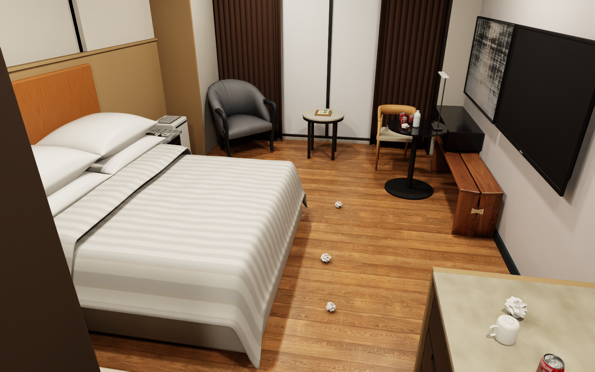
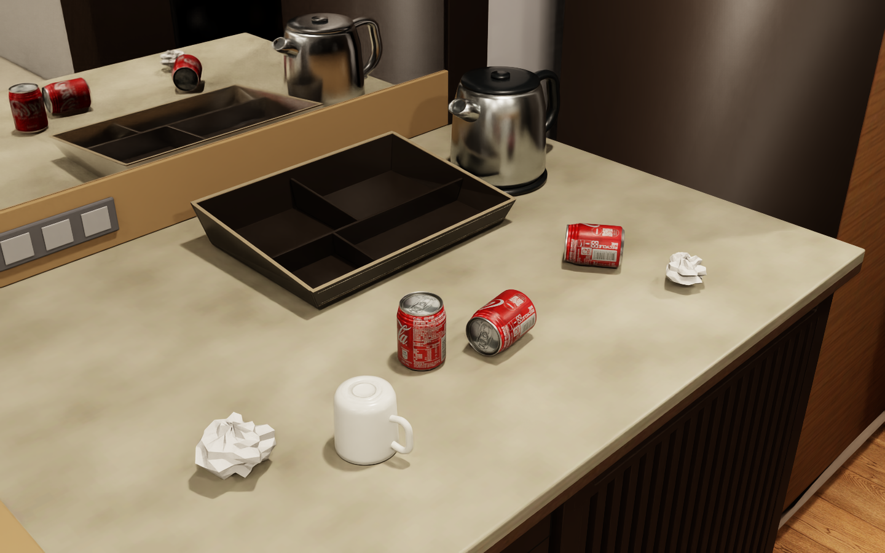

# 705 飯店房間隨機雜物場景

Reproducible hotel-room clutter scenes for NVIDIA Isaac Sim 5.1, with a photo-textured Coca-Cola can, room geometry, textures and editable Blender source.

用 seed 在 7052 房間產生可重現的雜物配置，供物件搜尋、感知與機器人任務整合使用。




## 下載完整包

到 [v1.0.0 Release](https://github.com/yfan62858/hotel705-random-clutter/releases/tag/v1.0.0) 下載 **hotel705-random-clutter-v1.0.0-full.zip**，解壓縮整個資料夾。

完整包包含程式、啟動腳本、房間 USD、Blender 原檔、房間貼圖、可樂模型與貼圖。GitHub 自動提供的 Source code ZIP 與 `git clone` 包含程式和說明，資產由 Release 完整包提供。

## 執行環境

- NVIDIA Isaac Sim **5.1** 獨立安裝版，使用安裝目錄內的 `python.bat` 或 `python.sh`。
- Isaac Sim 相容的 NVIDIA RTX 顯示卡、驅動與作業系統。硬體需求請見 [NVIDIA 官方文件](https://docs.isaacsim.omniverse.nvidia.com/5.1.0/installation/requirements.html)。
- 已在 Windows、RTX 5070、Isaac Sim 5.1 的 Direct3D 12 實際執行。Linux 啟動腳本完成語法檢查，GPU 執行尚待驗證。

## Windows 開啟場景

在解壓後的資料夾開啟 PowerShell，將安裝路徑換成自己的 Isaac Sim 路徑。

```powershell
.\start.bat -IsaacSimPath "C:\isaacsim" -Seed 705 -Level medium
```

也可以先設定環境變數，再雙擊 `start.bat`。

```powershell
[Environment]::SetEnvironmentVariable('ISAAC_SIM_PATH', 'C:\isaacsim', 'User')
```

設定後重新開啟終端機或檔案總管，讓新程序取得環境變數。首次啟動會載入房間、編譯 shader，等到控制面板顯示 `Ready` 再操作。

## 控制面板

| 控制項 | 用途 |
| --- | --- |
| Seed | 輸入整數，相同 seed 和雜亂程度可重現配置 |
| Clutter | 選擇 clean、low、medium 或 high |
| Generate this seed | 套用目前 seed 與 Clutter |
| New random layout (seed + 1) | seed 加一並產生下一個配置 |
| Restore clean room | 載入乾淨房間 |
| Room / Tabletop / Floor | 切換觀察角度 |
| Save screenshot | 將目前畫面存成該場景資料夾內的 snapshot.png |

關閉 Isaac Sim 視窗即可結束。產生配置時會短暫執行物理支撐檢查，完成後時間軸停在暫停狀態。

| 程度 | 移動原房間備品 | 可樂 | 揉紙團 | 總數 |
| --- | --- | --- | --- | --- |
| clean | 0 | 0 | 0 | 0 |
| low | 4 | 2 | 3 | 9 |
| medium | 7 | 4 | 7 | 18 |
| high | 9 | 7 | 13 | 29 |

備品包含水瓶、杯子、茶包與餅乾。部分 high 配置會有橫躺的可樂。每個 episode 的雜物採 kinematic 剛體，適合固定配置下的觀察與搜尋。

## 輸出位置

所有生成結果都在解壓後的專案資料夾內。

```text
scenes/medium_seed_705/
  hotel705_clutter.usda
  objects.json
  runtime_validation.json
  snapshot.png              # 按 Save screenshot 後產生
```

`hotel705_clutter.usda` 以相對路徑引用 `assets/`，搬移場景時請連同完整專案資料夾。重跑相同程度與 seed 會更新同一個場景目錄，其他 seed 各有自己的目錄。

`objects.json` 包含物件類別、世界座標、包圍盒、支撐面與 seed，可用於評估。此入口提供場景與互動檢視，自己的機器人、相機、ROS 及導航請依計畫整合。詳見 [操作與整合說明](docs/USAGE.md)。

## 自動產圖與檢查

```powershell
# 產生場景、檢查實際 PhysX 支撐並輸出四個視角，完成後結束
.\start.bat -IsaacSimPath "C:\isaacsim" -Seed 706 -Level high -Preview

# 確認完整包內模型與貼圖的 SHA-256
& "C:\isaacsim\python.bat" .
erify_assets.py

# 四種程度 × 三個 seed，檢查重現性、重疊及資產引用
& "C:\isaacsim\python.bat" .
erify_generator.py
```

## Linux

```bash
export ISAAC_SIM_PATH="$HOME/isaacsim"
bash ./start.sh --seed 705 --level medium
bash ./start.sh --seed 706 --level high --preview
"$ISAAC_SIM_PATH/python.sh" ./verify_assets.py
```

模型尺寸、來源與可互動房間結構見 [資產說明](docs/ASSETS.md)。
